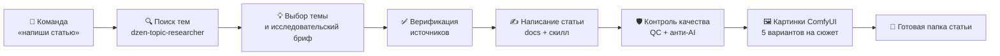

# Автогенератор статей для Дзена

Проект дзен-канала «Логика вещей»: полный конвейер производства статей на Claude Code — от поиска зарубежных трендов до готовых картинок и проверенного текста, готового к публикации.

## 🎯 Проблема

Ведение канала требует больших трудозатрат на создание контента:

- найти тему, интересную читателям;
- написать 4–5 тысяч знаков живым русским языком с учётом паттернов и инфостиля;
- проверить юридическую и площадочную легальность;
- придумать и сгенерировать картинки к тексту.

## 👤 Пользователь

- Проект создан под конкретный канал для личного пользования.
- Полезен любому блогеру, копирайтеру или автору на Дзене после настройки под свою тематику.

## ⚙️ Как работает конвейер

Вход — простая команда: **«напиши статью»**.

1. **🔍 Поиск тем.** Суб-агент `dzen-topic-researcher` ищет трендовые темы на зарубежных сайтах, ведёт журнал тем в памяти (резерв кандидатов, чёрный список повторов) и возвращает 7 вариантов с hook-ами. Пока идёт поиск новых тем, автору предлагается резерв из предыдущих поисков — ожидание не простаивает.
   
   
2. **Выбор темы и бриф.** Автор выбирает тему; собирается исследовательский бриф: тезис, аудитория, структура виральности, ключевые факты.
   
3. **Верификация источников.** Суб-агент и основная сессия перечитывают источники целиком — сводки помечаются как данные для перепроверки, без них статья не пишется.
   
4. **Написание.** Статья на русском языке пишется по базе знаний `docs/` (инфостиль, виральность, правила Дзена) и скиллу `dzen-viral-writer`.
   
5. **Контроль качества.**
   - грамматика и лексика;
   - юридический фильтр (законодательство РФ);
   - анти-AI проход по 38 паттернам AI-слопа;
   - честность фактов (неподтверждённые пересказы помечаются);
   - анти-робот проход: зачины и финалы не повторяются между статьями;
   - правила Дзена для картинок;
   - скрипт `check_article.py` проверяет объём текста и соответствие шаблону имени файла.
     
6. **Картинки.** Локальный ComfyUI (SDXL-модель RealVisXL V5) генерирует по 5 seed-вариантов на обложку и каждую иллюстрацию; обложки кропаются до 1080×608.
     
     

**Выход:** папка статьи — `.md` с YAML-фронтматтером и служебным разделом (источники, промпты картинок, параметры генерации) плюс комплект PNG с вариантами на выбор.
.png)
.png)

## 📤 Что получается

Готовая к публикации статья в Markdown + 20 картинок (обложка 1080×608, иллюстрации 1344×768) с пятью вариантами на каждый сюжет. От автора остаётся только выбрать варианты картинок и вставить текст в Дзен-студию.

## ✅ Готовый функционал (MVP)

- Конвейер «команда → темы → бриф → статья → контроль качества → картинки» (этапы 1–5 скилла) — отработан на 16 статьях.
- Журнал тем суб-агента: резерв кандидатов и защита от повторов.
- Контроль правил сохранения: шаблон имени файла, лимиты Windows, отдельная папка на статью.
- Генерация картинок по 5 вариантов на каждый сюжет.
- Версионирование проекта (Git/GitHub).

## 🗺️ Дорожная карта (toDo)

- Дообучить стиль под личный «голос» канала (реализовано частично).
- Автоматическая переделка формата статьи после одобрения.
- Подбор более качественной локальной модели для генерации картинок (или переход на MCP).
- Единая стилистика промптов картинок.
- Обратная связь по аналитике Дзена (CTR, дочитывания) в выбор тем.
- Масштабирование: быстрая настройка конвейера под любое число каналов.

## 🛠️ Технологии

| Слой | Инструменты |
|---|---|
| Оркестрация | Claude Code: markdown-скиллы (`.claude/skills/dzen-viral-writer`), суб-агент (`.claude/agents/dzen-topic-researcher.md`), память агента (`.claude/agent-memory/`), правила проекта |
| Поиск фактов | Веб-поиск, WebFetch/curl, разбор HTML скриптом на Python |
| Картинки | ComfyUI 0.43 локально (SDXL RealVisXL_V5.0_fp16), HTTP API, Python + PIL для кропа, воркфлоу в JSON |
| Контроль качества | Скрипт `check_article.py` (объём, шаблон имени, лимиты Windows) + ручные проходы по справочнику 38 AI-паттернов и таблицам канцелярита |
| Форматы | Markdown, PNG, JSON |
| Версионирование | Git, GitHub |
